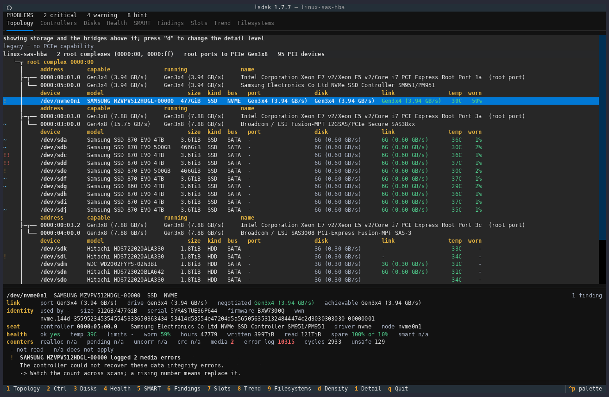
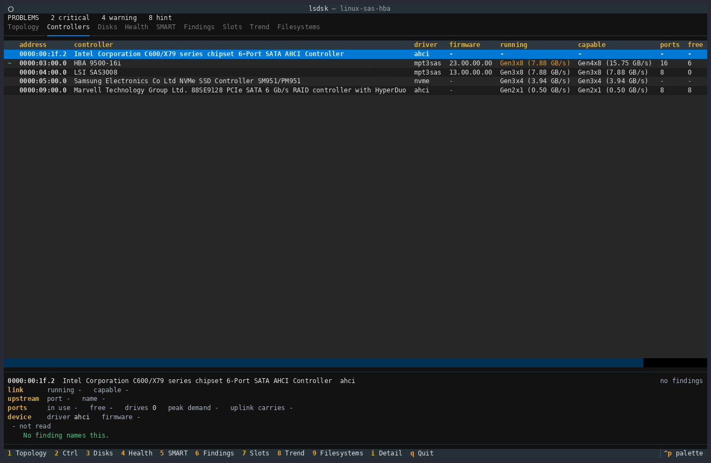
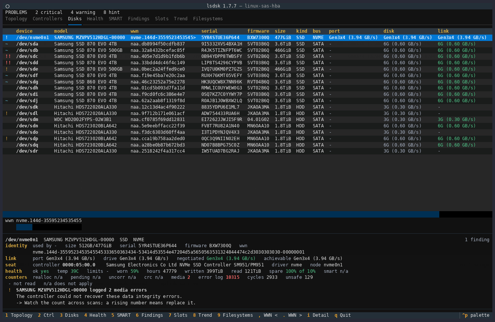
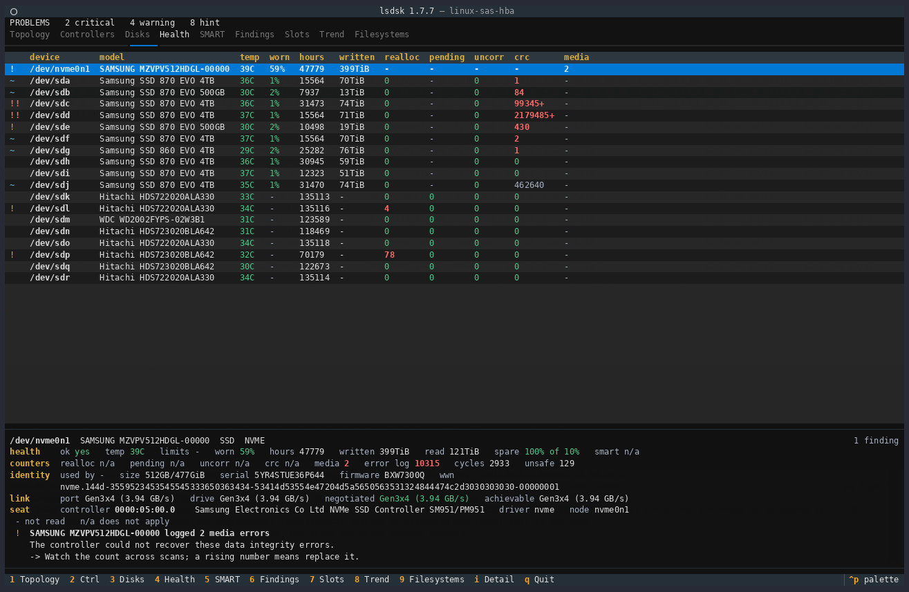
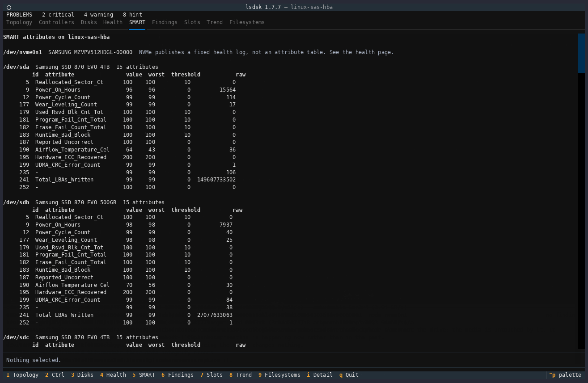
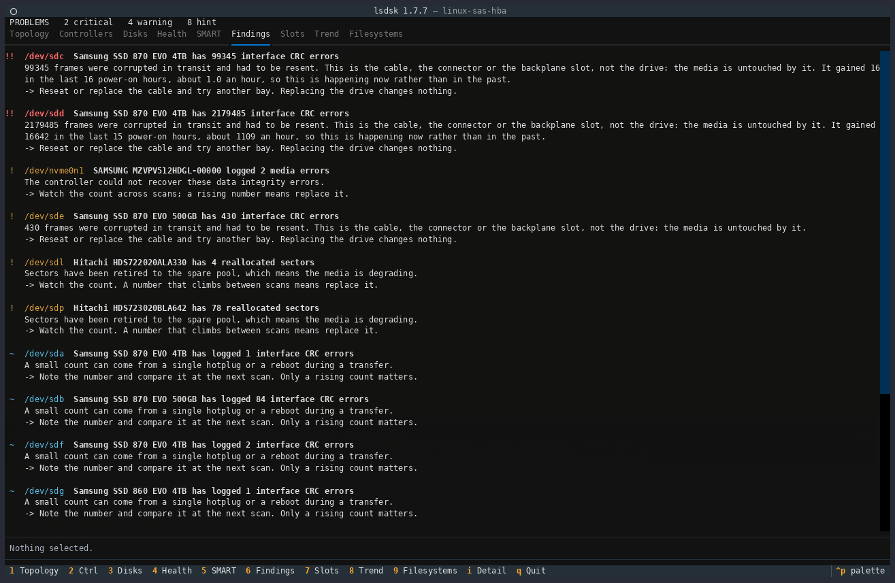
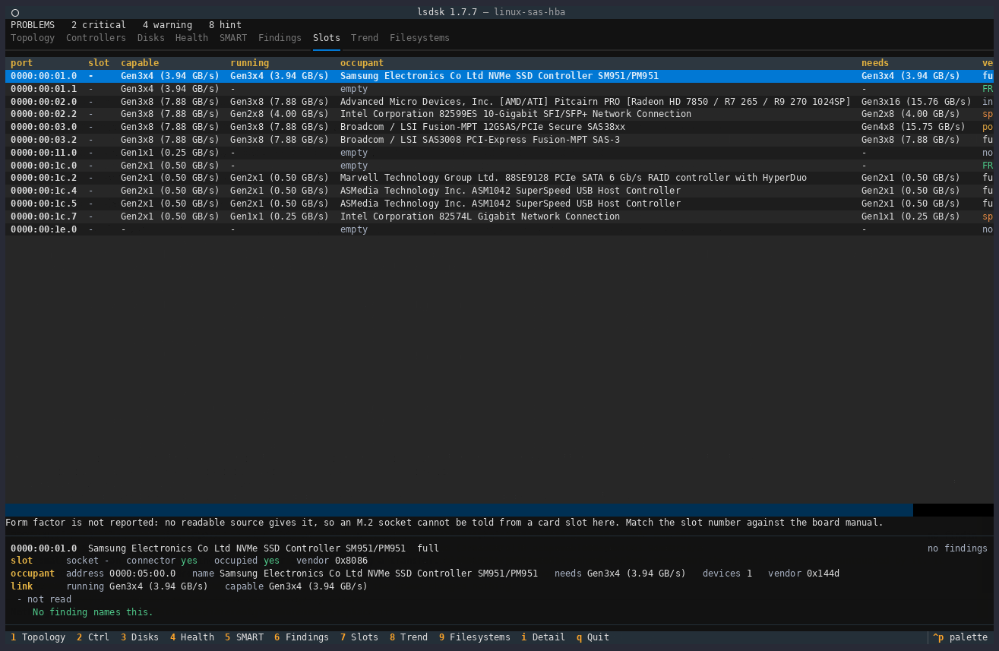
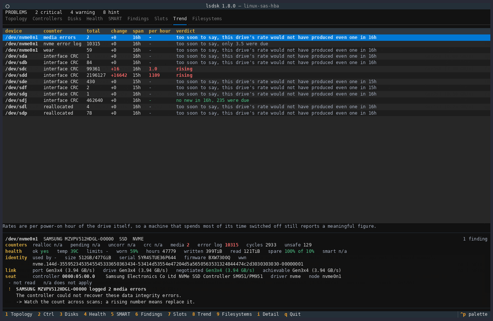
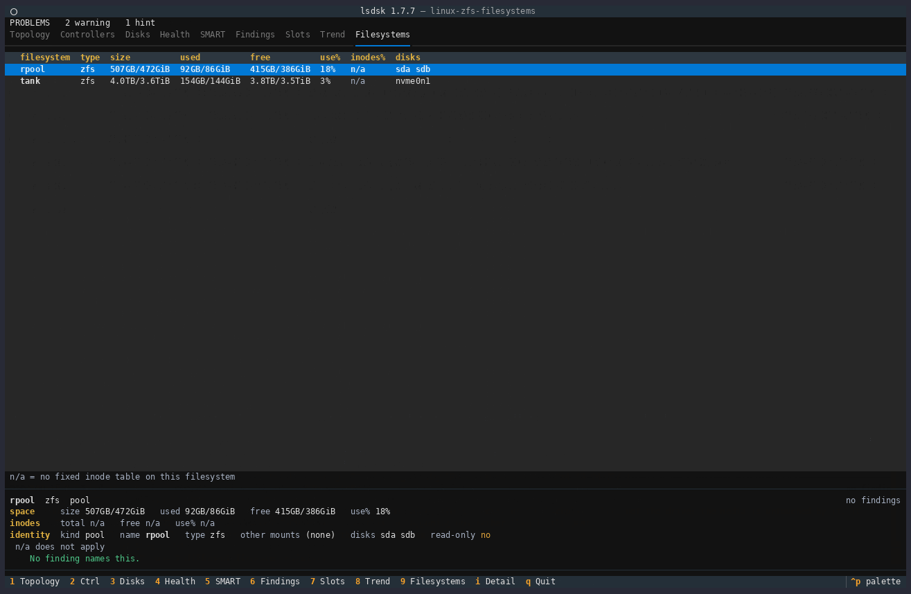

# Die neun Seiten

[English](../PAGES.md) | **Deutsch**

Eine Seite je Thema, in der Reihenfolge, in der die Zifferntasten sie erreichen.
Jede Seite entspricht einem Unterbefehl, der dieselbe Ansicht als Text ausgibt, `4` und
`lsdsk health` sind also eine Sache unter einem Namen. Zurück zur
[README](README.md).

Die interaktive Ansicht wird bedient wie die `*top`-Familie: `1` bis `9` oder
die zugehörige Funktionstaste wechseln die Seite, `q` oder `escape` beendet. Die Fußzeile
führt diese auf, es ist also nichts auswendig zu lernen. `left`, `right`, `tab`
und `shift+tab` schalten ebenfalls zwischen den Seiten weiter, und `r` oder `f10` liest neu
ein, ohne in der Fußzeile zu erscheinen. Die Seiten tragen dieselben Namen wie
die Befehle, in derselben Reihenfolge, `4` und `lsdsk health` sind also dieselbe
Ansicht mit denselben Spalten. Jede Seite steht für sich und zeigt jede Platte,
es muss also nichts ausgewählt werden, um eine zu lesen.

Sieben der neun Seiten führen außerdem einen Cursor - Topologie, Controller,
Platten, Gesundheit, Steckplätze, Verlauf und Dateisysteme -, den `up` und `down` bewegen. Eine
Tafel unter der Tabelle antwortet für das, worauf der Cursor steht: jeder Wert,
für den die Zeile keine Spalte hatte, dann die Befunde, mit
Begründung und Abhilfe. `i` blendet die Tafel aus und gibt der Tabelle den ganzen
Bildschirm; `shift+up` und `shift+down` rollen darin und werden nur angeboten,
wenn der Eintrag höher ist als die Tafel. SMART und Befunde führen keinen
Cursor, rollen als ganze Seite, und die Tafel liest dort `Nothing selected.`

Auf der Topologieseite schaltet `d` um, wie detailliert die PCI-Struktur dargestellt wird,
dieselbe Einstellung, die `--tree-density` für jede Ansicht setzt. 
`,` und `.` scrollen die WWN, wenn nötig.

## 1 Topologie

Was defekt ist, kommt zuerst, dann die Maschine selbst: jeder Controller mit der
ausgehandelten Verbindung, und den Laufwerken darunter. 

## 2 Controller

Eine Zeile je Controller: Treiber und Firmware, laufend gegen möglich, wie viele
Anschlüsse er hat und wie viele frei sind, und was die Laufwerke daran gemeinsam
ziehen würden.

## 3 Platten

Eine Zeile je Laufwerk, mit der Kennung, die Sie für eine Ersatzbestellung
brauchen: Modell, WWN, Seriennummer und Firmware, dann Größe, Bus und die drei
Geschwindigkeiten. `port` ist, was der Steckplatz hergibt, `disk`, was das
Laufwerk kann, `link`, worauf die beiden sich geeinigt haben. 
`size` zeigt die Größe in Dezimal und in Zweierpotenzen.
Die letzte Spalte, `used by`, zeigt, ob das System von der Platte startet und was sie nutzt: `-`,
wo das nicht gelesen wurde, `not mounted`, wo gelesen wurde und nichts die Platte nutzt, sonst die
Startmarkierung und die Einhängepunkte, den Pool oder die Struktur, zu der sie gehört, etwa
`boot zfs:rpool` oder `lvm:vg0 -> /var`. `not mounted` heißt nicht, dass die Platte gefahrlos
gelöscht werden kann: Eine an eine virtuelle Maschine durchgereichte Platte, ein Mitglied von
Speicherplätzen (Storage Spaces) oder ein exportierter ZFS-Pool kann es ebenso zeigen. Siehe
[FINDINGS.md](FINDINGS.md#was-eine-platte-nutzt-und-was-not-mounted-bedeutet) für die genauen
Bedingungen, unter denen `not mounted` gilt und wann stattdessen `-` steht.

## 4 Gesundheit

Verschleiß, Temperatur, Betriebsstunden und geschriebene Bytes, daneben die
Zähler, die entscheiden, ob ein Laufwerk stirbt oder nur schlecht verkabelt ist:
umgelagerte, schwebende und nicht korrigierbare Sektoren, CRC-Fehler der
Schnittstelle und Medienfehler.

## 5 SMART

Jedes Attribut jedes Laufwerks, mit Wert, schlechtestem Wert und Schwelle neben
der Rohzahl, denn eine Rohzahl allein hat wenig Aussagekraft. 
NVMe-Laufwerke veröffentlichen statt einer Attributtabelle ein festes Gesundheitsprotokoll, und die Seite zeigt dieses an.

## 6 Befunde

Jeder Befund mit seiner Begründung darunter und einer Empfehlung zur Abhilfe: was gemessen
wurde, was es bedeutet, und was dagegen zu tun ist.

## 7 Steckplätze

Jeder PCIe-Anschluss: was er leisten kann, was er fährt, was ihn belegt, was
dieser Belegung fehlt, und ein Urteil. `FREE` ist ein leerer Anschluss, `full`
heißt, dass die Belegung ausnutzt, was der Anschluss bietet, und eine
Restzahl ist die Bandbreite, die derzeit niemand verwendet.

## 8 Verlauf

Die Zähler im Zeitverlauf, statt nur einem Wert: die Änderung seit der
letzten Messung, die Spanne, über die sie gemessen wurde, eine Rate pro Stunde,
und ein Urteil. Zwei Laufwerke lesen hier `rising`. Eines liest
`no new in 16h, 235 were due`, ein Zähler, der zu steigen aufgehört hat. 
Der Rest sagt `too soon to say`, solange nicht genug Zeit zwischen zwei Messungen vergangen ist.

## 9 Dateisysteme

Wie voll jedes eingehängte Dateisystem, jeder ZFS-Pool und jedes Windows-Volume auf einer Platte
ist, so wie `df` es meldet: Größe, belegt und frei, dann `use%` und, wo das Dateisystem seine Inodes
beim Formatieren anlegt, `inodes%`. Ein ZFS-Pool ist eine Zeile, gleich welche Datasets er enthält.
`-` kennzeichnet eine Zahl, die niemand gelesen hat, und `n/a` eine Inode-Zahl für ein Dateisystem,
das Inodes nach Bedarf anlegt, sodass es keine Tabelle zu füllen gibt; eine Zeile unter der Tabelle
nennt, welches von beiden die Tabelle gezeichnet hat. Eine Zeile, auf die ein Befund zutrifft, trägt
die Markierung dieses Befunds. Siehe [FINDINGS.md](FINDINGS.md#wie-voll-ein-dateisystem-ist), wann
ein Füllstand zum Befund wird.

Die Spalte `frag` sagt, wie zerstückelt der freie Platz ist, auf der Skala, die `zpool list`
in seiner Spalte `FRAG` verwendet: 0 % ist freier Platz in großen Stücken, 100 % freier Platz in
kleinen. Ein ZFS-Pool meldet die Zahl von ZFS selbst, ext4 und xfs werden aus ihren freien Extents
bewertet und ein Windows-Volume aus seiner Volume-Bitmap, wofür eine Sitzung mit erhöhten Rechten
nötig ist; ein Windows-Lauf ohne diese zeigt in jeder `frag`-Zelle `-`, mit der Legende
`- = not read`, und ein Satz unter der Tabelle nennt den Grund:
`Not read: fragmentation (needs Administrator).` Jede andere Dateisystem-Lesung, die das System für
die ganze Maschine verweigert hat, etwa die Liste der ZFS-Pools, wird auf dieselbe Weise genannt.
Hier heißt `n/a`, dass das Dateisystem keine solche Zahl hat, und `-`, dass es eine geben könnte und
sie nicht gelesen wurde. `frag` ist die erste Spalte, die wegfällt, wenn das Terminal schmaler wird.
Sie wird nur angezeigt und nie zum Befund.

Der Cursor füllt die Tafel mit dem, wofür die Tabelle keine Spalte hat: jeden weiteren Einhängepunkt
des Dateisystems mit Namen, wo die Zeile `+N` sagt, die Platten, auf denen es liegt, das
Schreibschutz-Flag, die rohen Inode-Zahlen, eine Gruppe `free space` (`fragmentation`, `free extents`, `largest` und
`average`) und jede vom System verweigerte Lesung samt Grund. Eine
Zeile, deren Zahlen nicht gelesen wurden, etwa ein Einhängepunkt, den ein darüber eingehängter
verdeckt, zeigt `-` und den Grund, nie eine Zahl. Zwei Zeilen können denselben Namen tragen, daher
folgt die Tafel der Zeile und nicht dem Namen.
